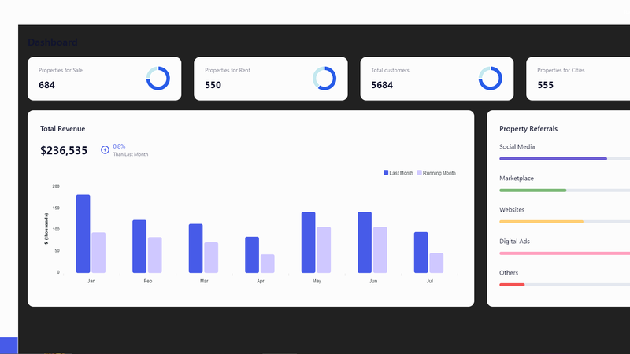
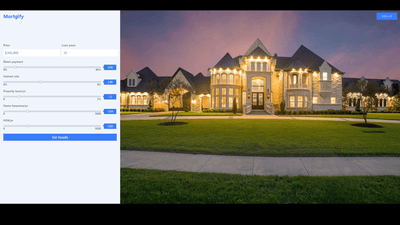
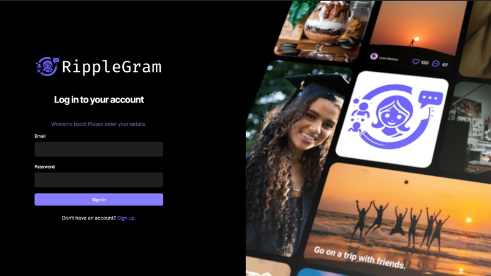
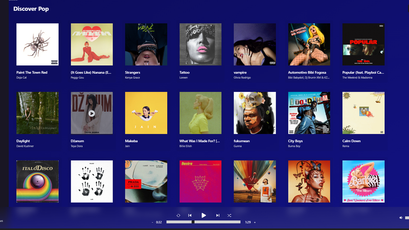

<a id="readme-top"></a>

<!-- HERO BANNER WITH TOP/BOTTOM GRADIENT FADE -->
<div align="center">
  
</div>

<br />

<div align="center">
  <h1>Hello World, I'm RayAnthoney 👋</h1>
  <p><strong>Full-Stack Software Engineer & Creative Technologist</strong></p>
  <p>
    <a href="https://bsky.app/profile/rayanthoney.bsky.social" target="_blank"></a>
    <a href="https://x.com/rayanthoney" target="_blank"></a>
    <a href="https://www.instagram.com/rayanthoney/" target="_blank"></a>
    <a href="mailto:contact@rayanthoney.com"></a>
    <a href="https://rayanthoney.com" target="_blank"></a>
  </p>
</div>

---

### 🎇 About Me 🌟

<p align="center">
I am a Software Engineer and Freelancer focused on full-stack web development. Welcome to my digital haven! I'm thrilled to share my journey and passion for software engineering with you. Stay tuned as I craft a space that showcases my projects, skills, and the endless possibilities that code unlocks. ✨ I'm <em>excited</em> to bring you along for the 🎢 ride!
</p>

```text
⚡ Current Focus: Full-Stack React / Next.js Architecture • Cloud Integrations • Interactive Web UI
🌱 Always Learning: Three.js • Distributed Systems • Advanced TypeScript
```

---

### 🛠️ Tech Stack

#### 🎨 Frontend
<p>
  
  
  
  
  
  
  
  
  
</p>

#### 🔧 Backend & Database
<p>
  
  
  
  
  
  
  
</p>

#### 🚀 DevOps & Tooling
<p>
  
  
  
  <a href="https://github.com/rayanthoney/100Devs-Bootcamp/tree/master/code-wars" target="_blank"></a>
</p>

---

### 💻 Featured Projects

<div align="center">
  <table width="100%">
    <tr>
      <td width="50%" valign="top" align="center">
        <a href="https://github.com/codingphasedotcom/nextjslanding" target="_blank">
          
        </a>
        <br /><br />
        <h3>Project 01 — Next.js Landing</h3>
        <p>
          <a href="https://github.com/codingphasedotcom/nextjslanding" target="_blank">
            
          </a>
          <a href="#" target="_blank">
            
          </a>
        </p>
        <p><strong>Next.js • Tailwind CSS • Firebase</strong></p>
        <p>Dynamic user authentication, responsive UI with Tailwind, and real-time data sync using Firebase.</p>
      </td>
      <td width="50%" valign="top" align="center">
        <a href="https://youtu.be/XQqhiYAtR9g" target="_blank">
          
        </a>
        <br /><br />
        <h3>Project 02 — Mortgage Calculator</h3>
        <p>
          <a href="https://github.com/rayanthoney/CodingPhase-Labs/tree/master/practical-javascipt/scenario4-mortgage-calculator" target="_blank">
            
          </a>
          <a href="https://youtu.be/XQqhiYAtR9g" target="_blank">
            
          </a>
        </p>
        <p><strong>HTML5 • CSS3 • JavaScript</strong></p>
        <p>Interactive loan calculator with live range sliders, real-time formula computation, and dynamic chart visualization.</p>
      </td>
    </tr>
    <tr>
      <td width="50%" valign="top" align="center">
        <a href="https://github.com/rayanthoney/javascriptmastery/tree/main/jsm_react-tailwind-socialmedia" target="_blank">
          
        </a>
        <br /><br />
        <h3>Project 03 — Ripple Social</h3>
        <p>
          <a href="https://github.com/rayanthoney/javascriptmastery/tree/main/jsm_react-tailwind-socialmedia" target="_blank">
            
          </a>
          <a href="#" target="_blank">
            
          </a>
        </p>
        <p><strong>React • Tailwind CSS • Appwrite • TanStack Query</strong></p>
        <p>Full-stack social media application featuring infinite scroll, media uploads, likes, saves, and user authentication.</p>
      </td>
      <td width="50%" valign="top" align="center">
        <a href="https://github.com/rayanthoney/javascriptmastery/tree/main/jsm_react-tailwind-spotify" target="_blank">
          
        </a>
        <br /><br />
        <h3>Project 04 — Music App</h3>
        <p>
          <a href="https://github.com/rayanthoney/javascriptmastery/tree/main/jsm_react-tailwind-spotify" target="_blank">
            
          </a>
          <a href="#" target="_blank">
            
          </a>
        </p>
        <p><strong>React • Tailwind CSS • Redux Toolkit • RapidAPI</strong></p>
        <p>Spotify 2.0 clone featuring track search, artist exploration, top charts, and synchronized lyrics playback.</p>
      </td>
    </tr>
  </table>
</div>

---

<p align="center">
  <sub>Designed with ❤️ by <a href="https://github.com/rayanthoney">RayAnthoney</a></sub>
</p>

<p align="right">(<a href="#readme-top">back to top ⬆️</a>)</p>


